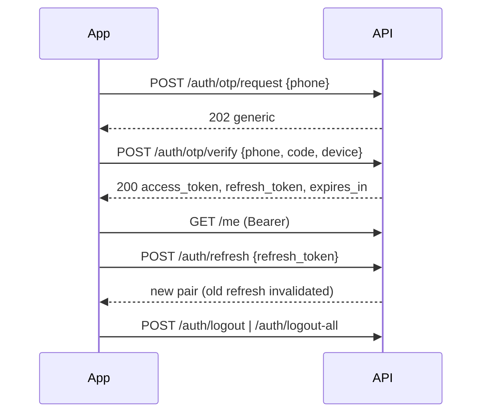

# API Architecture (Batch 5 draft)

Labels: [PINNED] baseline §12 · [RECOMMENDATION]. The API is a thin layer over the **same Actions** the web uses (no rules duplicated).

## 1. Conventions
| Topic | Rule |
|---|---|
| Base | `/api/v1`, JSON only (`application/json`), HTTPS only |
| Success | `{ "data": …, "meta": …, "links": … }`; resources never raw models; ids = ULID `public_id` |
| Errors | RFC 9457 `application/problem+json`: `type`, `title`, `status`, `detail`, `code` (stable, e.g. `stock.insufficient`, `payment.verification_failed`, `validation.failed`), `errors{field:[…]}`, `request_id`. Messages localised by `Accept-Language` |
| Money | `{ "amount_minor": 125000, "currency": "BDT", "formatted": "৳ 1,250.00" }` |
| Localised content | resolved server-side; response echoes `locale`; fallback bn→en |
| Time | ISO-8601 UTC with offset; clients convert to Asia/Dhaka |
| Pagination | catalog/search: page-based `page`, `per_page` (max 60) + `meta`; orders/notifications/feeds: cursor `cursor`, `limit` |
| Filter/sort | `filter[category]=…&filter[price_min]=…`, `sort=-created_at` (allow-listed fields only) |
| Caching | ETag + `If-None-Match` on catalog reads; `Cache-Control` per route; gzip/brotli |
| Request id | `X-Request-Id` accepted/echoed; in logs |
| Idempotency | `Idempotency-Key` required on: checkout place, payment initiate, refund request, booking confirm, cart-to-order. Same key+body → stored response; same key+different body → `409 idempotency.conflict`; TTL 24 h |
| Rate limits | tiers below; `429` + `Retry-After` + `RateLimit-*` headers |
| Versioning | URI major; additive changes only within v1; breaking → v2. Deprecation: `Deprecation` + `Sunset` headers, ≥ 6-month overlap [proposal] |
| Docs | OpenAPI 3.1 generated from code (evaluate Scramble vs L5-Swagger — ADR in Phase 11), committed, CI diff gate, contract tests |

## 2. Rate-limit tiers [RECOMMENDATION]
| Tier | Applies to | Limit |
|---|---|---|
| T0 public-read | catalog, config | 120/min/IP |
| T1 search | search, autocomplete | 60/min/IP |
| T2 auth | login, register, refresh | 10/min/IP + 5/min/identifier |
| T3 otp | OTP send/verify | 3 sends/10 min/number, 10/hour/IP, global daily cap + alert |
| T4 user-read | authenticated GETs | 120/min/token |
| T5 write | cart, address, review | 60/min/token |
| T6 critical | checkout, payment, refund, booking | 10/min/token + idempotency |
| T7 webhook | gateway/courier callbacks | 300/min/IP, body ≤ 1 MB |

## 3. Authentication
- **Web:** Laravel session + CSRF (cookie), not used by API clients.
- **Mobile/API:** Sanctum personal access tokens with abilities (`customer`), device name, expiry. Policy [RECOMMENDATION]: access token 60 min + refresh token 30 days with **rotation and reuse detection** (reuse ⇒ revoke family). Sanctum has no native refresh tokens — implement `refresh_tokens` table (hashed) in IdentityAccess [UNVERIFIED against current Sanctum docs; ADR in Phase 11].
- **Guest:** `POST /auth/guest` is **not** provided; guest cart uses `X-Cart-Token` (signed, opaque). Guest checkout is allowed with phone; order access later via signed link/OTP.
- **Login methods:** email+password; phone+OTP (generic responses; no enumeration).
- Sensitive actions (change phone/email/password, delete account) require recent re-auth (`password` or OTP within 10 min).
- App version gate: `X-App-Version`, `X-App-Platform`; below `min_supported_version` → `426 app.upgrade_required`.

## 4. Authorisation
Same Policies as web. Every `{id}` route resolves resources **scoped to the actor** (e.g. `orders()->wherePublicId()` through customer relation) → other users' resources return `404`. Staff/admin APIs are not in v1.

## 5. Payments over mobile
`POST /payments` returns `{ redirect_url, return_scheme }`; app opens in-app browser; return deep link is UX only; app polls `GET /orders/{id}/payment` (server status). Server never trusts the app's claim of success.

## 6. Resource design rules
Dedicated Resource classes; no internal ids/columns; no mass assignment; images with size variants (`thumb`, `card`, `full`, WebP/AVIF URLs); enums exposed as stable strings; computed `available_actions` on orders (e.g. `cancel`, `return`, `pay`) so clients don't re-implement rules.

## 7. Mobile independence
Client needs only OpenAPI + integration guide (auth, payment deep-link, retry/offline, error codes, pagination, image sizes, push payloads). All pricing, stock, shipping, coupon, policy, eligibility logic is server-side; clients display `available_actions`, `formatted` money and server messages.

## 8. Push (Phase 11)
FCM behind `Push` channel contract; `POST /devices`; payloads contain no sensitive data, localised by stored locale.

## 9. Security
No secrets in responses; token storage guidance (Keychain/Keystore); optional certificate pinning with rotation plan; strict CORS (no browser clients expected); abuse signals (velocity, device) feed fraud rules; log redaction.

## 10. Testing
Parity tests (Web vs API same Action/results), IDOR suite for every `{id}`, idempotency storm, OpenAPI conformance on every response, golden bn/en responses, token rotation/reuse tests.
