# Database Design (Batch 3 draft) — MariaDB ≥ 11.4, InnoDB, utf8mb4

Labels: [VERIFIED-12.1.2] = tested on the local server 2026-10-28 · [PINNED] · [RECOMMENDATION]. Per-table detail: `DATABASE_DATA_DICTIONARY.md`.

## 1. Conventions
| Rule | Detail |
|---|---|
| Charset/collation | `utf8mb4` / `utf8mb4_uca1400_ai_ci` (same as `velmora`, `velmora_test`). Bangla ordering to be tested in Phase 3. Store text NFC-normalised (app-side). |
| PK | `id BIGINT UNSIGNED AUTO_INCREMENT` (internal only) |
| Public id | `public_id CHAR(26) CHARACTER SET ascii COLLATE ascii_bin NOT NULL UNIQUE` (ULID) on every externally visible entity |
| Money | `<name>_minor BIGINT NOT NULL` + `currency CHAR(3) NOT NULL DEFAULT 'BDT'`; `CHECK (<name>_minor >= 0)` unless signed by design (ledger deltas). No FLOAT/DOUBLE/DECIMAL in PHP math |
| Time | `DATETIME(6)` in UTC; connection `time_zone='+00:00'`; no `TIMESTAMP` (2038/implicit defaults). Display Asia/Dhaka |
| Enums | `VARCHAR(32)` + `CHECK (col IN (...))`, mirrored by PHP enum [VERIFIED CHECK enforced] |
| FKs | all relations; `ON DELETE RESTRICT` default; `ON UPDATE RESTRICT` |
| Soft delete | `deleted_at DATETIME(6) NULL` only on catalog/CMS/customer-facing content. Never on financial/stock/audit tables |
| Append-only | `BEFORE UPDATE/DELETE` triggers `SIGNAL SQLSTATE '45000'` + app DB user lacks UPDATE/DELETE grant [VERIFIED trigger blocks both]. Applies to: `audit_events`, `stock_movements`, `order_status_history`, `shipment_events`, `payment_transactions` (status columns excepted — see dictionary), `refunds` (status excepted), `download_logs`, `booking_events`, `cod_collections` |
| JSON | only provider payloads/free-form; MariaDB `JSON` = validated LONGTEXT (not indexable) → queried keys promoted to columns |
| Hierarchy | closure tables (no ltree) |
| Audit columns | `created_at`, `updated_at` on mutable tables; `created_by`/`updated_by` (user id) on admin-edited tables |
| Naming | snake_case plural tables; module prefix only where ambiguous (`cms_pages`, `service_bookings`) |
| Isolation | write paths run `READ COMMITTED` (ADR-014); default is REPEATABLE-READ [VERIFIED] so set per transaction/connection |

## 2. ER overview (whole system, key entities)

```mermaid
erDiagram
  users ||--o| customers : has
  customers ||--o{ customer_addresses : has
  users }o--o{ roles : assigned
  products ||--o{ product_translations : has
  products ||--|{ product_variants : has
  products }o--|| brands : of
  products }o--o{ categories : in
  product_variants ||--o{ prices : priced
  product_variants ||--o{ stock_levels : stocked
  stock_locations ||--o{ stock_levels : holds
  product_variants ||--o{ stock_movements : ledger
  product_variants ||--o{ stock_reservations : reserved
  carts ||--o{ cart_items : has
  orders ||--|{ order_items : has
  orders ||--|| order_addresses : snapshot
  orders ||--o{ order_status_history : history
  orders ||--o{ payments : paid_by
  payments ||--o{ payment_transactions : attempts
  payments ||--o{ refunds : refunded
  payments ||--o{ payment_webhook_events : events
  orders ||--o{ shipments : shipped_as
  shipments ||--o{ shipment_items : contains
  shipments ||--o{ shipment_events : tracked
  order_items ||--o{ entitlements : grants
  digital_assets ||--o{ entitlements : delivers
  service_definitions ||--o{ service_packages : offers
  service_resources ||--o{ service_bookings : booked
  order_items ||--o| service_bookings : fulfilled_by
  coupons ||--o{ coupon_redemptions : redeemed
  orders ||--o{ coupon_redemptions : uses
```

Per-module ER diagrams are generated from migrations in Phase 1 and must match the dictionary (CI check).

## 3. Product-type modelling [PINNED]
`products.product_type ∈ {physical,digital,service}`; 1:1 extension tables `digital_assets` (per variant) and `service_definitions` (per product). Fulfilment rules chosen by type; stock tables only for physical. CHECK/trigger prevents `track_inventory=1` on non-physical.

## 4. Localisation approach
Normalised `<entity>_translations(entity_id, locale, …)` with `UNIQUE(entity_id, locale)` and `UNIQUE(locale, slug)`. JSON-per-column rejected: cannot constrain/index per locale. FK `locale → languages.code`.

## 5. Concurrency playbook
Each pattern was executed on MariaDB 12.1.2 where marked.
| # | Scenario | Pattern | Failure prevented |
|---|---|---|---|
| 1 | Last unit purchased by two customers | `UPDATE stock_levels SET reserved=reserved+:q WHERE variant_id=:v AND location_id=:l AND on_hand-reserved>=:q;` affected rows 0 ⇒ insufficient [VERIFIED 1 then 0]. CHECKs `on_hand>=0, reserved>=0, reserved<=on_hand` as last defence [VERIFIED error 4025]. Multi-line: process `variant_id` ascending | Oversell, deadlock |
| 2 | Deadlock/lock-wait | Retry ≤3 on errno 1213/1205 with jitter, whole transaction | Spurious failures |
| 3 | Duplicate payment callback | `INSERT IGNORE INTO payment_webhook_events(provider,provider_event_id,…)` UNIQUE; affected 0 ⇒ duplicate, return 200 [VERIFIED 1 then 0]. Processing job: `SELECT … FROM payments WHERE id=:p FOR UPDATE`, then idempotent transition (no regress from terminal) | Double-paid |
| 4 | Amount/ref mismatch | compare `amount_minor,currency,merchant_ref` from `verify()` to payment row; mismatch ⇒ status `needs_review`, event, no paid | Wrongly-paid |
| 5 | Over-refund | In txn: `SELECT … FROM payments WHERE id=:p FOR UPDATE; SELECT COALESCE(SUM(amount_minor),0) FROM refunds WHERE payment_id=:p AND status IN ('requested','processing','succeeded');` require sum+new ≤ captured; INSERT refund | Refund > captured |
| 6 | Coupon limit | `UPDATE coupons SET used_count=used_count+1 WHERE id=:c AND (usage_limit IS NULL OR used_count<usage_limit);` affected 0 ⇒ exhausted; the UPDATE also row-locks the coupon so the per-customer count check that follows is serialised; `INSERT coupon_redemptions` UNIQUE(coupon_id,order_id) | Over-redemption |
| 7 | Booking double-book | `UNIQUE(active_resource_id, slot WITHOUT OVERLAPS)` with `active_resource_id = IF(status IN('held','confirmed'),resource_id,NULL)` [VERIFIED: 20 parallel → 1 success; cancelled rows don't block] | Double booking |
| 8 | Order number | `CREATE SEQUENCE order_number_seq NOCACHE; NEXTVAL(order_number_seq)` [VERIFIED]; format `ORD-YYMM-` + zero-padded (≥6 digits). Gaps possible on rollback (acceptable) | Duplicate numbers |
| 9 | Order state race (cancel vs ship) | `SELECT … FROM orders WHERE id=:o FOR UPDATE` before any axis transition; state machine rejects illegal transition; history row in same txn | Inconsistent state |
| 10 | Download limit | `UPDATE entitlements SET downloads_used=downloads_used+1 WHERE id=:e AND status='active' AND (download_limit IS NULL OR downloads_used<download_limit) AND (expires_at IS NULL OR expires_at>UTC_TIMESTAMP(6));` | Over-download |
| 11 | License key | `SELECT id FROM license_keys WHERE pool_id=:p AND status='available' ORDER BY id LIMIT 1 FOR UPDATE SKIP LOCKED` then update [VERIFIED syntax] | Key issued twice |
| 12 | Idempotent POST | `INSERT INTO idempotency_keys(scope,`key`,request_hash,…)` UNIQUE(scope,key); on duplicate compare hash: same ⇒ replay stored response, different ⇒ 409/422 | Double order |
| 13 | Outbox consume | `SELECT … FROM outbox_messages WHERE status='pending' AND available_at<=UTC_TIMESTAMP(6) ORDER BY id LIMIT :n FOR UPDATE SKIP LOCKED` | Double dispatch by workers |
| 14 | Reservation expiry | job: `UPDATE stock_reservations SET status='expired' WHERE status='active' AND expires_at<=now` (batch by id) then release counts per row under lock; commit-after-expiry rejected by status check | Stuck stock |
| 15 | Stock ledger integrity | nightly: `on_hand = SUM(stock_movements.delta)` per (variant,location); mismatch ⇒ alert | Silent drift |
Reservation-vs-movement rule (ADR-013): `reserved` changes on reserve/release; `on_hand` + a `stock_movements` row change **only** on shipment (−), receipt (+), adjustment, return restock.

## 6. Indexing strategy (each serves a query)
| Index | Query |
|---|---|
| `orders(public_id)` UNIQUE, `orders(order_number)` UNIQUE | lookup by link / number |
| `orders(customer_id, created_at)` | account history |
| `orders(status, created_at)`, `orders(payment_status, created_at)` | admin queues |
| `order_addresses(phone)` | support search / COD velocity |
| `payments(status, created_at)` (no partial index in MariaDB) | reconcile pending |
| `payments(order_id)`, `payment_transactions(payment_id)`, UNIQUE`(provider, provider_txn_id)` | joins / dedupe |
| UNIQUE `payment_webhook_events(provider, provider_event_id)` | idempotency |
| `product_translations`: UNIQUE`(locale, slug)`, FULLTEXT`(name,short_description)` | PDP by slug; search |
| `products(status, published_at)` | storefront listings |
| `product_variants`: UNIQUE`(sku)`, `(product_id)` | SKU lookup |
| `stock_levels` PK`(variant_id, location_id)` | reserve |
| `stock_reservations(status, expires_at)`, `(order_id)` | expiry job |
| `stock_movements(variant_id, location_id, id)` | ledger check |
| `shipments`: UNIQUE`(courier, courier_consignment_id)`, `(order_id)` | webhook match |
| `outbox_messages(status, available_at)` | dispatcher |
| `audit_events(subject_type, subject_id, created_at)`, `(actor_id, created_at)` | audit viewer |
| `coupons(code)` UNIQUE | apply |
| `customer_addresses(customer_id)`; geography by parent id | address cascades |
Every FK has an index. EXPLAIN on a 10k-product / 1M-order synthetic set is a Phase 3/10 gate.

## 7. Transaction boundaries
| Operation | Boundary |
|---|---|
| PlaceOrder | one txn (reserve → coupon → order+lines+history → outbox → clear cart) |
| Payment event processing | one txn per event; verify() call **before** BEGIN |
| Refund request/approve | txn for guard+insert; provider call after commit, result recorded in second txn |
| Shipment create | txn: shipment + items + outbox; courier call async |
| Stock adjustment | txn: movement + level |

## 8. Soft delete, audit, retention
| Data | Policy |
|---|---|
| Catalog/CMS | soft delete; purge after 2 y [ASSUMPTION] |
| Orders, payments, refunds, ledgers, audit | never deleted; Digital Commerce Guidelines reportedly require records ≥ 6 y [UNVERIFIED — lawyer] |
| Raw webhook payloads | JSON kept 18 months then nulled (row stays) [ASSUMPTION] |
| OTP challenges | purge 7 days after expiry |
| Search queries | aggregate after 90 days, no PII |
| Customer deletion | anonymise PII, keep financial rows (PDPO status NEEDS-LAWYER) |
Partitioning: **not yet** — revisit when `orders`/`audit_events`/`stock_movements` exceed ~50 M rows.

## 9. Migration order (each file single-purpose, forward-only, expand→migrate→contract)
1 platform (languages, settings, audit_events, idempotency_keys, outbox_messages, sequences, jobs) → 2 geography → 3 identity (users, roles, permissions, otp, mfa, tokens) → 4 customers/addresses → 5 catalog (taxonomy, products, translations, variants, attributes, media) → 6 pricing/tax → 7 inventory → 8 cms/search → 9 shipping config → 10 coupons/promotions → 11 carts → 12 orders → 13 payments → 14 shipments/returns → 15 digital → 16 services → 17 engagement/support → 18 notifications → 19 integrations → 20 reporting summaries → 21 triggers (append-only) & grants. DDL auto-commits (non-transactional) ⇒ never mix DDL and data backfill in one migration.

## 10. Seed strategy
Reference seeds idempotent (`updateOrCreate` by natural key): languages, roles/permissions, geography (source + date in header; 🔎 BBS/LGD), tax classes, status enums, default settings, policy text stubs. Demo seed (≥40 products) only in local/staging. Never seed credentials.

## 11. Open items
Tax-rate/VAT values (verify, Q6) · `commission`/vendor out of scope (ADR-028) · group-capacity bookings (Phase 8) · geography dataset licence · FULLTEXT behaviour on 1–2 letter Bangla words.
