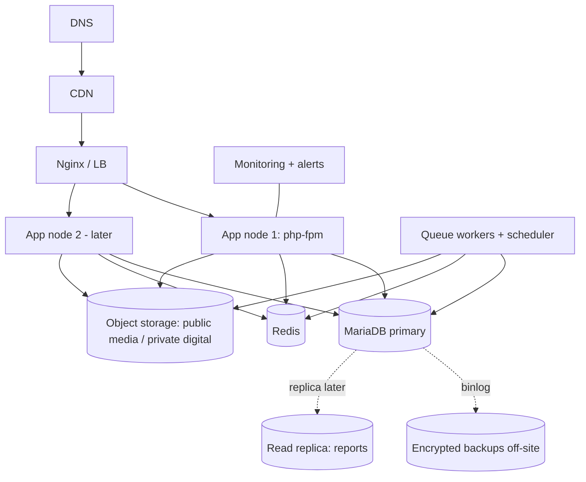

# Deployment and DevOps (Batch 6 draft)

SMS (Q5): **SSL Wireless ISMS Plus** (requires registered Sender ID and a whitelisted server IP — the production egress IP must be stable/static; add to go-live checklist). Hosting (Q7) and email provider are **unanswered → defaults logged as assumptions**: Linux VPS/cloud, region nearest Bangladesh latency-wise, MariaDB (self-managed or managed MariaDB), Redis, S3-compatible storage. Data-residency obligations [NEEDS-LAWYER]. Managed-MariaDB availability varies by provider — check before choosing.

## 1. Environments
| Env | Purpose | Data | Providers |
|---|---|---|---|
| local | dev (Docker Compose: php-fpm, nginx, MariaDB, Redis, SeaweedFS (S3-compatible), Mailpit) | seeded demo; current dev DB `velmora`, tests `velmora_test` | fakes/log |
| CI | ephemeral | factories | fakes |
| staging | prod mirror | anonymised/synthetic | provider sandboxes |
| production | live | real | live (human cutover) |

## 2. CI/CD
GitHub Actions: build once (composer install --no-dev, assets build) → artefact → deploy. Branch protection; required checks (Testing doc §4); tagged releases; changelog. Deploy: zero-downtime — new release dir, `php artisan migrate --force` (expand-only), queue drain/restart (`horizon:terminate`), health-gated symlink switch, instant rollback = previous release (migrations backward-compatible because contract steps ship in a later release). Because MariaDB DDL is non-transactional, migrations are single-purpose and rehearsed on staging with production-sized data.

## 3. Configuration and secrets
`.env.example` documents every variable; boot-time validation fails fast on missing secrets; secrets in a manager/vault or encrypted env, never in repo; provider credentials entered by a human in admin (encrypted) or env at go-live; rotation procedure documented. DB roles: `app` (DML, no DDL, no UPDATE/DELETE on append-only tables), `migrator` (DDL), `readonly_reporting`.

## 4. Backups
Daily full + continuous binlog (PITR) using mariadb-backup or equivalent; encrypted, off-site; object-storage versioning; retention 35 d daily / 12 m monthly [ASSUMPTION]; **monthly automated restore verification**; documented RTO ≤ 4 h / RPO ≤ 15 min.

## 5. Monitoring and alerting
Uptime checks (storefront, checkout, webhook endpoints); error tracking; APM and slow-query alerts; Horizon/queue lag; scheduler heartbeat; metrics: orders/min, payment success rate, pending payments age, callback failure/signature failures, mismatch count, refund failures, deadlock retries, SMS spend, stock-ledger integrity job, disk/CPU/memory, DB replication (if any). Alert routing with severity and escalation (on-call rota is a bus-factor mitigation).

### 5.1 Payment alerts and scheduled jobs (Phase 6)
The scheduler (one `schedule:run` per minute) runs: `payments:expire-unpaid` (every minute), `payments:poll-refunds` and `payments:check-health` (every 5 minutes), `payments:reconcile-pending` (every 10 minutes), plus the outbox dispatcher. `payments:check-health` writes an ERROR log line `payments.alert` with `signal`, `value` and `threshold` for each breached signal (once an hour per signal): `callback_failure_rate`, `pending_too_long`, `amount_mismatches`, `refund_failures`, `forged_notifications`. **Alert on that log line**, and on the scheduler heartbeat. Thresholds: `PAYMENTS_ALERT_*` and `PAYMENTS_RECONCILE_AFTER_MINUTES`, `PAYMENTS_LONG_PENDING_HOURS` (see `config/payments.php`). Finance sees the same signals as a banner on *Money today* and *Payment settings*.

### 5.2 Going live with payments (human steps, in this order)
1. Test first: put the **sandbox** store id and password (they end in `@ssl`) into `PAYMENT_SSLCOMMERZ_STORE_ID` / `PAYMENT_SSLCOMMERZ_STORE_PASSWORD`, keep `PAYMENT_SSLCOMMERZ_SANDBOX=true`, switch the "online" method on in *Payment settings*, and run the sandbox suite (`SSLCOMMERZ_SANDBOX_TESTS=1`, see `app/Modules/Payments/tests/Sandbox/README.md`). Never put live credentials on a development machine.
2. In the production secret store set the **live** store id/password, `PAYMENT_SSLCOMMERZ_SANDBOX=false` and, as the deliberate last switch, `PAYMENTS_ALLOW_LIVE=true`. The live gateway is reachable only when `APP_ENV=production`, sandbox is off **and** `PAYMENTS_ALLOW_LIVE=true`; any one missing keeps the shop on the sandbox.
3. Register the notification address (`POST /api/v1/webhooks/payments/sslcommerz`) and the return pages with the provider; confirm what the provider requires (IP allow-list) from its dashboard.
4. A human places one real order of the smallest amount, confirms it shows *paid*, requests a refund of it, approves it with a second person and checks the money came back.
5. Rollback: *Payment settings → Pause online payments* (cash on delivery keeps working; in-flight payments still reconcile), then clear `PAYMENTS_ALLOW_LIVE`.
6. The owner confirms tax settings with the adviser before payments go live (`tax.enabled` stays false until then).

## 6. Runbooks (to write in Phase 12/13)
Payment stuck · gateway outage (payment-freeze) · courier outage (ManualCourier) · stock mismatch · SMS provider failure · queue backlog · DB failover/restore · rollback · secret leak · pen-test finding triage · COD fraud spike.

## 7. Deployment architecture

## 8. Rollout and cutover (Phase 13)
Soft launch (staff/friends) → limited audience (flags/invite) → public. Live provider cutover per provider: credentials entered by human, callback URLs/IPs whitelisted, controlled live smoke test with owner-authorised minimal amount incl. refund, rollback to "COD only". Hypercare: 14 days with twice-daily dashboard review and daily payment/COD reconciliation. The AI prepares scripts and checklists; **a human executes anything touching production or real money**.

## 9. Go-live checklist (summary)
Phase 12 go decision · restore rehearsal passed · security findings Critical/High = 0 · policies reviewed by counsel · tax settings confirmed by adviser · providers approved · alerts verified firing · rollback rehearsed · support SOPs ready · payment-freeze < 2 min · DNS/TLS ready.
