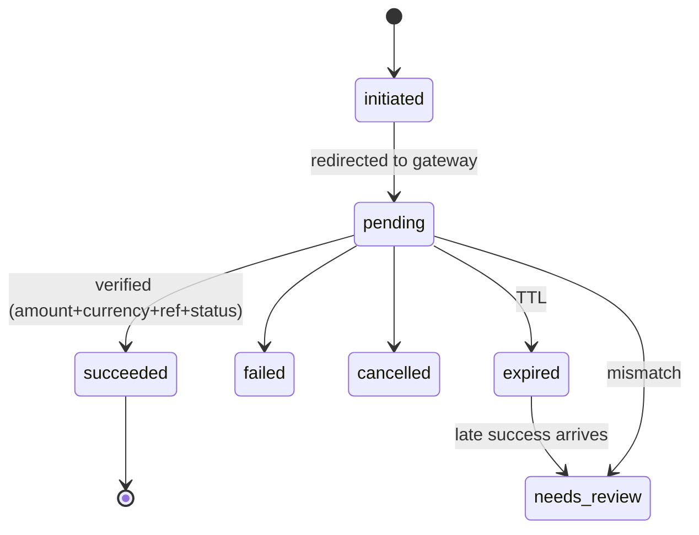

# Payment Integration Design (Batch 4 draft)

Labels: [VERIFIED-official 2026-10-28] read from the provider's official page · [UNVERIFIED] · [PINNED]. Provider selection (Q3): **SSLCommerz + bKash** (owner). bKash is taken through SSLCommerz in the MVP (SSLCommerz lists bKash as a method); a direct bKash adapter is a later option once bKash's official docs are in hand (third-party wrappers disagree on endpoint paths, so nothing is assumed). The design is provider-independent; the design is provider-independent and SSLCommerz is used as the worked example because its official page was readable.

## 1. Gateway contract (`Payments/Contracts/PaymentGateway`)
`initiate(PaymentIntent): InitiationResult` · `verify(VerificationRequest): VerifiedPayment` (server-to-server) · `parseCallback(HttpPayload): CallbackEvent` · `refund(RefundRequest): RefundResult` · `refundStatus(ref)` · `status(ref): VerifiedPayment` · `capabilities(): Capabilities{ refund, partialRefund, statusQuery, signedCallback, sandbox }`. `GatewayRegistry` resolves by `payment_methods.provider`. Capabilities are declared per adapter **from saved official docs** and surfaced in admin; a refund on a provider lacking the capability becomes a manual-refund record.

`VerifiedPayment` = { provider_txn_id, merchant_ref, amount_minor, currency, status, raw (redacted), risk_flag }. Money is converted from provider decimal strings to minor units in the adapter only (string math, no floats).

## 2. State machines
**payments.status:** `initiated → pending → paid | failed | cancelled | expired`; `paid → (refund tracked via refunded_minor)`; any non-terminal → `needs_review`.
**payment_transactions.status:** `initiated → pending → succeeded | failed | cancelled | expired` (terminal never regresses; enforced by trigger and Action).
**refunds.status:** `requested → approved → processing → succeeded | failed`; `requested → rejected`.
**orders.payment_status** is updated only by the `PaymentSucceeded/Failed/RefundSucceeded` listeners in Orders; Orders never calls Payments.

## 3. Flow (see `SYSTEM_ARCHITECTURE.md` §6)
1. `InitiatePayment`: create `payments` + `payment_transactions(initiated)` with unique `merchant_ref` (our reference: the order number plus the attempt, e.g. `VM-2610-000123-2`; readable on a bank statement and within SSLCommerz's 30-character `tran_id`), call `initiate()` outside any stock/order lock, store provider session key, status `pending`, redirect.
2. **Return URL** (success/fail/cancel): UX only. Page shows "verifying…" and dispatches `VerifyPayment`; polls own status endpoint. Query params are never trusted.
3. **IPN/webhook:** controller stores raw event (`INSERT IGNORE`, UNIQUE(provider,provider_event_id); when the provider has no event id, derive `sha256(provider|txn_id|status|amount|timestamp)`), returns 200 immediately, queues `ProcessPaymentEvent`.
4. Job: authenticate per provider → `verify()` → `BEGIN; SELECT payment FOR UPDATE` → compare amount, currency, merchant_ref, status → idempotent transition → outbox `PaymentSucceeded` → `COMMIT`.
5. `ReconcilePendingPayments` (every few minutes): pending older than N min → `status()` → same path.

**Implemented in slice 3 (SSLCommerz):** see `docs/vendor/sslcommerz/README.md` for what the adapter relies on and what it does not. Decisions: a closed-but-unpaid attempt can still become succeeded (for 7 days) because the gateway may report a failed try and then a success under one `tran_id`; the page address the gateway returns must be https on `*.sslcommerz.com`; live mode needs production + sandbox off + `PAYMENTS_ALLOW_LIVE`; `partialRefund` is not declared until the sandbox shows it works.

**Implemented in slice 2 (decisions):** the payment's `expires_at` is 30 minutes (`PAYMENTS_EXPIRY_MINUTES`); the expiry job asks the gateway before closing; an expired payment's attempts stay open so a late success is recorded as `late_success` (payment → `needs_review`, order untouched if cancelled), never silently paid; a second paid attempt on a paid payment is a `duplicate_payment` exception (money to give back); orders follow payments only through outbox events (`payments.initiated/succeeded/failed/expired/needs_review`); the return URL is signed and CSRF-exempt, the notification route is `POST /api/v1/webhooks/payments/{provider}`.

## 4. Edge cases (each = automated test, Phase 6)
| Case | Handling |
|---|---|
| Duplicate callback | unique event → no-op 200 |
| Callback before browser return / return before callback | both converge on same verified transition |
| Forged success redirect | no verified record → order stays unpaid |
| Forged IPN | rejected: server-to-server `verify()` finds no matching valid transaction |
| Amount/currency/ref mismatch | `needs_review`, alert, never paid |
| Late success after expiry | `needs_review`; policy ADR: auto-refund if stock gone, else re-open order |
| Out-of-order events | terminal states never regress; stale event recorded `ignored` |
| Provider timeout during initiate | transaction stays `initiated`; reconciliation resolves |
| Retry after failure | new transaction, same payment |
| Parallel attempts on one order | only first verified success marks paid; extras flagged for auto-refund |
| App crash after commit | outbox redelivers `PaymentSucceeded`; consumer idempotent |
| Duplicate "already validated" | treated as success-replay, not error |

**Where each edge case above is tested (slice 4):** every row is a story in `app/Modules/Payments/tests/Feature/PaymentReplayTest.php` (checked against the money invariants after every step) and, for the races, a real multi-process test in `tests/Database/PaymentConcurrencyTest.php`: duplicate callback; callback before/after browser return; forged success redirect and forged IPN; amount / currency / reference mismatch; late success after expiry or after the order was cancelled; out-of-order events (a late "failed" never undoes "paid"); parallel attempts on one order; app crash after commit (outbox redelivery); "already validated" replays.
**Known limit:** an attempt that closed unpaid is re-checked with the gateway for 7 days after it started. A success reported later than that is not picked up by a notification; the settlement-file / reconciliation step (slice 7) is what catches provider payments we have no paid record for (`unmatched_provider_txn`).

## 5. SSLCommerz facts [VERIFIED-official, developer.sslcommerz.com/doc/v4, 2026-10-28]
- IPN: POST to listener URL (merchant panel or `ipn_url`); statuses VALID, FAILED, CANCELLED, UNATTEMPTED, EXPIRED. IPN carries `verify_sign` / `verify_key`; **the page does not document how to compute `verify_sign`** → our adapter authenticates via the **Order Validation API**, not by signature.
- Validation: GET `…/validator/api/validationserverAPI.php` with `val_id`, `store_id`, `store_passwd`, `format`; results VALID / VALIDATED (already validated) / INVALID_TRANSACTION. Must check `tran_id`, `amount`, `currency` against our DB.
- Transaction query by `sessionkey` or `tran_id` (`merchantTransIDvalidationAPI.php`): VALID, VALIDATED, PENDING, FAILED.
- Refund: same host path; params `bank_tran_id`, `refund_trans_id` (unique, required), `refund_amount`, `refund_remarks`; response `status` success/failed/processing with `refund_ref_id`; refund-status query by `refund_ref_id` (refunded/processing/cancelled). **Partial refund not stated** [UNVERIFIED]. Live refund requires registering our public IP.
- Sandbox separate store id/host; separate registration. `risk_level` flag: hold fulfilment for risky txns.
- Methods listed: cards, bKash, DBBL Mobile Banking, Upay, internet banking. **Nagad not mentioned** [UNVERIFIED].
- Implication: credentials travel as GET query parameters → **mask query strings in logs/APM**; HTTP client must redact. Map our refund idempotency key to the unique `refund_trans_id`.
- ShurjoPay: official page 404 on 2026-10-28 [UNVERIFIED]. aamarPay: overview only says redirect-back + later notification; verification and refund not stated [UNVERIFIED]. bKash direct: official docs not retrievable 2026-10-28 (404 / only third-party wrappers: flow create→execute→query, refund and refund-status exist per wrappers, partial refunds reportedly up to 10 per txn, query keyed by paymentID, paths conflict between sources) [UNVERIFIED]. Nagad: not researched.

## 6. Refund design
`RequestRefund` → `ApproveRefund` (`payments.refund`; two-person rule above threshold, configurable) → `ExecuteRefund`. Guard §5 of `DATABASE_DESIGN.md`. If `capabilities().refund` false → manual refund record (method `manual`, proof reference, who/when). Gateway "processing" ≠ done: poll `refundStatus` before `succeeded`. Refund of a COD order = manual payout record. Digital: revoke entitlement per policy; service: per cancellation policy.

### 6.1 As built (slice 5)
- **Over-refund guard:** reserved = refunds in requested/approved/processing/succeeded. `payments.refunded_minor` equals the reserved total on the *primary* (first succeeded) attempt and is raised by one conditional `UPDATE … AND refunded_minor + ? <= captured_minor` under the payment row lock; CHECK `refunded <= captured` is the backstop. Reject / gateway refusal release the reservation. A duplicate paid attempt is refundable up to its own amount and does not touch `payments.refunded_minor`.
- **Routing (`RefundRouting`):** gateway only if the adapter declares refund, the bank transaction id is known and the amount is the whole attempt (unless `partialRefund` is declared); otherwise manual. Staff may force manual.
- **Approval:** above `payments.refund_second_approver_minor` (default ৳5,000; 0 = no limit) the approver must differ from the requester.
- **Sending:** lock payment then refund; one process wins approved→processing; the gateway is called with our `refund_ref`; an unreachable gateway leaves `processing` with no gateway id and the same call (same ref) is repeated after 60 s. Accepted/processing stays `processing` until `refundStatus` reports refunded (`PollRefunds`, every 5 minutes); stuck over 3 days raises `refund_stuck`.
- **Manual:** approved → succeeded only with a proof reference.
- **Order effect:** `RefundSucceeded` (detail full|partial|extra) through the outbox; the order listener is idempotent.
- **Tests:** `RefundTest` (38) and `tests/Database/RefundConcurrencyTest` (7, real processes).

## 7. COD lifecycle
`order placed (cod_pending_collection)` → courier delivered event → `cod_collections` row (AO, UNIQUE(shipment_id)) → `cod_remittances` per courier statement with items → reconcile: match sum and per-consignment amounts; short/over → `reconciliation_exceptions`. Aging report for uncollected and unremitted. COD eligibility/fee: rules by zone, order value, customer risk (Phase 5).

### 7.1 As built (slice 6)
- **Collection:** `RecordCodCollection` takes the amount from the order (via the `Orders\Contracts\CodOrders` contract), inserts payment (paid), collection and one succeeded attempt (`merchant_ref` `COD-<order number>`) in one transaction and announces `payments.succeeded` with detail `cod`. the unique marker `manual_marker` (one hand-recorded collection per order) on collections (and the unique merchant ref) stop a double recording; a cancelled order, an online order, a future date or a date before the order are refused. The order's payment status becomes `paid`; its progress is left to staff.
- **Refunds of cash:** the normal refund machinery; routing finds no `cod` adapter, so the refund is manual with proof.
- **Courier statements:** `RecordCodRemittance`; expected = sum of OUR collections; status reconciled / short / over / pending (parcel differs although the total agrees); exceptions `cod_short`, `cod_over`, `amount_mismatch` (once per statement). UNIQUE(courier, statement_ref) and UNIQUE(cod_collection_id) on items.
- **Aging:** `CodAging::report()`; screens arrive in slice 8; the settlement-file import and exception resolution in slice 7.
- **Not built (needs shipments, Phase 7):** automatic collection from a courier "delivered" event.

## 8. Reconciliation
Daily `DailySettlementImport` where provider supports statement files/API [UNVERIFIED per provider]; otherwise CSV upload. Exceptions: unmatched provider txn, matched-but-amount-differs, orphan internal payment, long-pending. Each resolvable with audit.

### 8.1 As built (slice 7)
- **Scheduled check:** `ReconcilePendingPayments` every 10 minutes (attempts open > 10 minutes are verified server to server; payments open > 2 hours past their limit raise `long_pending`).
- **Settlement file:** `ImportSettlement`. CSV `reference,bank_txn_id,amount,currency,settled_at`; provider-neutral by design [UNVERIFIED against SSLCommerz's real report: no saved document]. All-or-nothing validation; one check per file; exceptions: `unmatched_provider_txn` (reasons `not_ours`, `file_says_paid_we_do_not`, `bank_id_differs`), `amount_mismatch`, `currency_mismatch`, `orphan_payment` (paid here in the period, not in the file). The file is never proof of payment.
- **Closing:** `ResolveReconciliationException` (resolved / ignored + note); first closer wins; no money moves.
- **Later:** exceptions screen, upload form and permission `payments.reconcile` (slice 8); automatic daily import when a provider's statement API is documented and saved.

### 8.2 Admin screens (slice 8)
Pages under `/admin/payments`: `today`, list, `{payment}`, `refunds`, `cod`, `reconciliation`, `settings`. View = `payments.view`; refund request/approve/reject/send/complete = `payments.refund`; collect cash, courier statement, settlement upload, close an item, ask the gateway again, pause online payments = `payments.reconcile`; refund limit and offered methods = `settings.manage`. Raw gateway notifications are shown through `Redactor`; nothing about a payment's money can be changed from a screen except through the Actions (request/approve/send refund, record cash/statement, close an item, verify). Money typed in taka is read exactly (`ProviderAmount`, Bangla digits accepted), never as a float.

## 9. Secrets and security
Credentials in `integration_configs` (encrypted, masked in UI) or env; never logged. Webhook routes: no session/CSRF, rate-limited, body size cap, IP allow-list when provider publishes ranges [UNVERIFIED], replay window where a timestamp exists. Raw payload viewer redacted. Never store card data.

## 10. Sandbox test plan
Opt-in suite (not in CI default) against each provider's sandbox; CI uses a `FakeGateway` plus recorded fixtures for: success, failure, cancel, duplicate, delayed, forged, wrong amount, wrong currency, unknown reference, validation "already validated". Live smoke test is human-executed with owner-authorised minimal amount and a refund (Phase 13).

## 11. Payment-freeze switch
Admin feature flag disables all online methods (COD remains) in < 2 min; in-flight payments still reconcile.

## 12. Open
Q3 provider · refund-after-expiry policy · two-person refund threshold · whether bKash/Nagad come through the aggregator · fee display to customer.
