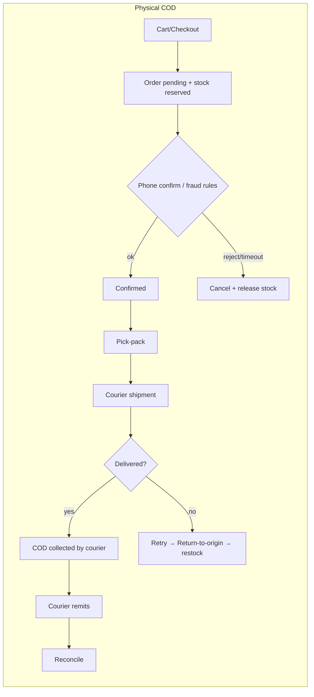
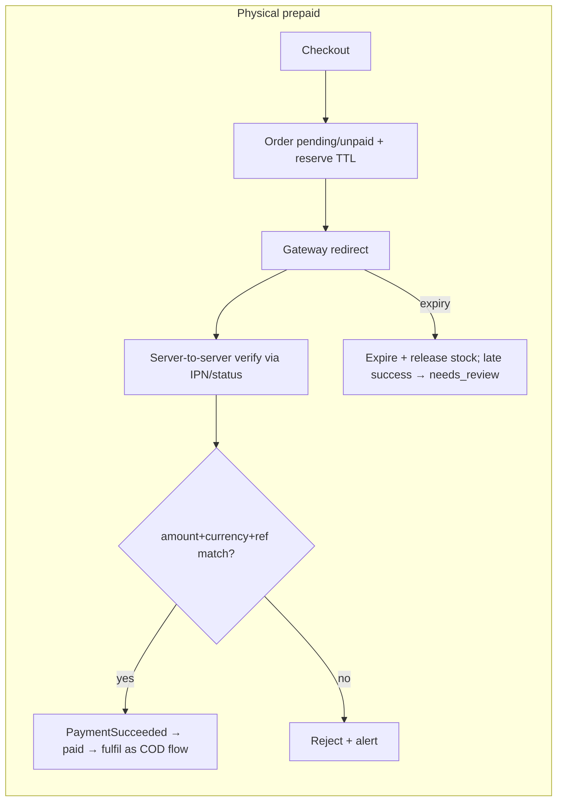
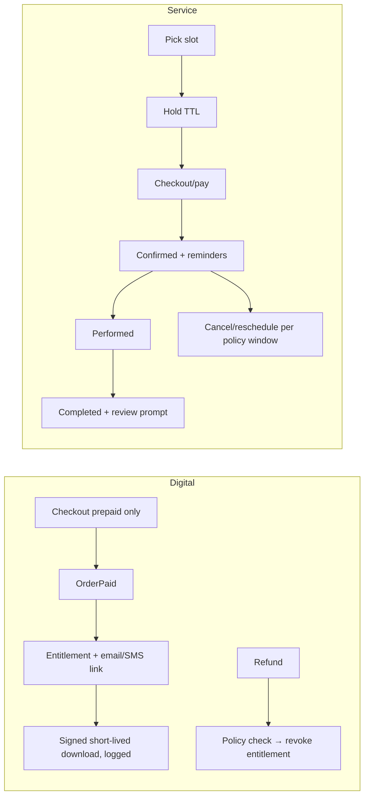
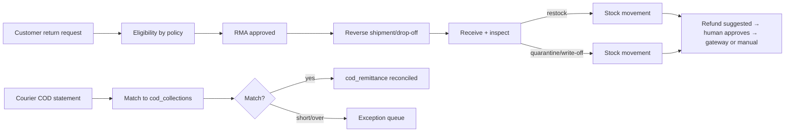

# Project Overview — Velmora

Status: **Phase 0 draft — awaiting owner sign-off** · Date: 2026-10-28

Velmora is a bilingual (en/bn) e-commerce platform for Bangladesh selling **physical products, digital products and services**. Stack (pinned in `AI_Prompts/02_BASELINE_DECISIONS.md`): Laravel + Blade + Tailwind/Alpine + **MariaDB/MySQL** (ADR-000, overrides PostgreSQL), modular monolith, versioned REST API for future Android/iOS apps.

Currency: BDT (৳), minor units. Timezone display: Asia/Dhaka. Languages: `en`, `bn` (extensible).

## Personas

| # | Persona | Jobs-to-be-done | Top frustrations |
|---|---|---|---|
| P1 | First-time Bangla-speaking mobile shopper on 3G | Find a product in Bangla, trust the shop, order with COD | Heavy pages, English-only UI, fear of fake shops/non-delivery, forced account creation, wrong Bangla rendering |
| P2 | Repeat urban shopper | Reorder fast, track parcel, pay by bKash/card | Re-typing addresses, no tracking, slow refunds, surprise delivery fees |
| P3 | Digital-goods buyer | Pay once, download immediately, re-download later | Broken links, unclear refund rules, lost access after device change |
| P4 | Service customer | Book a slot, know price/duration, reschedule | Double-booking, no reminders, unclear cancellation fee |
| P5 | Shop owner / admin | See sales, cash owed, stock, exceptions in one place | Reports that don't tie to cash, fraud/fake COD orders, dependency on developers |
| P6 | Warehouse / packing staff | Pick, pack, print label, hand to courier | Overselling, wrong stock, manual tracking-id entry |
| P7 | Support agent | Answer "where is my order/refund?" quickly; confirm COD by phone | Switching tools, no order context, no canned bn replies |
| P8 | Accountant | Daily close: collected vs refunded vs COD outstanding; VAT invoices | Gateway/courier statements not matching, manual reconciliation |

## Operational process maps (order-to-cash)

