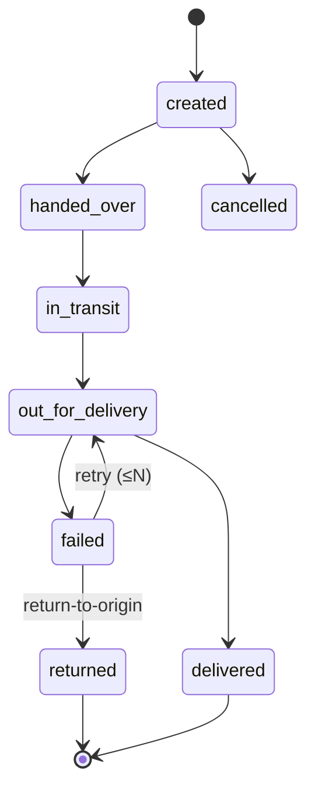

# Shipping and Fulfilment Design (Batch 4 draft)

Courier (Q4): owner may use **Steadfast, Pathao, RedX or Paperfly**; the contract is multi-provider (several `courier_accounts` active, choice per shipment/rule). First real adapter = whichever has verified official docs first (default Steadfast); ManualCourier always available. All courier-specific details below are [UNVERIFIED]; Pathao's merchant developer page returned only a title and Steadfast's official docs were not retrievable (community package suggests bearer-token webhooks, base URL differs between sources) on 2026-10-28.

## 1. Zone and rate model
- Geography: divisions → districts → upazilas (BD names). `shipping_zones` map to district/upazila sets: *Inside Dhaka*, *Dhaka suburbs*, *Outside Dhaka* + custom.
- `shipping_methods` per zone (standard/express/pickup) with bn/en labels and ETA text.
- `shipping_rates`: weight bands × order-value bands → `rate_minor`; `free_over_minor`; COD surcharge rule (flat or percent, min/max).
- Quote Action returns `ShippingQuote` DTO {method, rate, cod_fee, eta_text, cod_eligible, reasons}. Digital-only/service-only carts skip shipping. Weight = Σ variant weight_g × qty (volumetric weight configurable).
- Rate resolution order: most specific zone (upazila > district > default) → method → band; ties by explicit priority. Tested with fixtures.

## 2. COD eligibility
Rules (configurable, evaluated in order): zone allows COD; order value ≤ max; open-COD-order limit per phone; blocklist; velocity; customer risk score; product types (digital never COD). Failure returns reason code → UI offers prepay. COD orders: confirmation by phone/OTP above threshold; auto-cancel after N hours if unconfirmed (releases reservation).

## 3. Fulfilment workflow
`confirmed → processing` (pick list) → pack → `CreateShipment` (full or partial; items+qty) → handover → courier events → delivered/failed/returned. Stock: reservation committed (`on_hand` decremented + `stock_movements` row) **at shipment creation/handover** (ADR-013); cancel after shipment is not allowed (return flow instead). Cancel-vs-ship race resolved by `SELECT orders … FOR UPDATE`.

## 4. Courier contract (`Shipping/Contracts/CourierProvider`)
`createShipment()` · `cancelShipment()` · `track()` · `parseWebhook()` · `rateQuote()?` · `codSettlement()?` · `capabilities()`. Implementations: `ManualCourier` (staff enter tracking/status — always available) + first real provider after docs are saved to `docs/vendor/<courier>/`. Credentials in `courier_accounts` (encrypted). Payload PII minimised to what the courier needs.

## 5. Status model
Internal shipment statuses: `created, handed_over, in_transit, out_for_delivery, delivered, failed, returned, cancelled, unknown`. A `courier_status_map(provider, provider_status, internal_status)` table; unmapped ⇒ `unknown` + alert, order unaffected. Events stored append-only with `UNIQUE(shipment_id, provider_status, occurred_at)`; **final state computed by event timestamp, not arrival order**; polling job backs up webhooks.

## 6. Outcomes
- **Delivered:** order fulfilment axis updated; `CodCollected` emitted exactly once (UNIQUE shipment_id); review prompt scheduled.
- **Failed attempt:** reason code, attempts+1, customer notification, retry scheduling; after N → return-to-origin.
- **Returned:** receive-back + inspection → `restock` (movement +), `quarantine`, or `write_off`; order fulfilment axis `returned`/`partially_returned`; refund suggested, never auto-executed.
- **Lost/damaged:** exception queue; claim record.

## 7. Partial shipments
`shipment_items(order_item_id, quantity)`; `order_items.fulfilled_qty`; order fulfilment axis derived: all → `fulfilled`, some → `partially_fulfilled`. Each shipment has its own COD amount (sum = outstanding COD).

## 8. Courier reconciliation
Import courier statement (API if available, else CSV) → match by consignment id → compare delivered status, COD amount, courier fee → create/verify `cod_remittances` → exceptions (missing, short, extra, fee mismatch). Return-fee accounting recorded as courier charge expense lines [Reporting].

## 9. Customer tracking
Signed-link page (`orders/{public_id}/track?sig=…`) or number+phone; internal timeline bn/en; courier tracking URL when available; no sequential ids; rate-limited.

## 10. Admin
Shipment list/detail, bulk create, label/packing-slip PDFs (Bangla font embedded), status-mapping view, exception queue, courier settings with test-connection, manual status override with audit.

## 11. Tests (Phase 7)
Partial shipment stock; cancel-vs-ship race; out-of-order/duplicate events; unknown status; delivery→COD exactly once; return restock vs quarantine; courier down → ManualCourier; stock-take variance approval.

## 11a. As built (slices 1–3)
- **Tables:** shipments, shipment_items, shipment_events (append-only), courier_accounts (credentials encrypted), courier_status_map, shipment_exceptions. Over-shipping guarded by `order_items.fulfilled_qty` (CHECK ≤ quantity, one conditional UPDATE); the order row is the lock that settles cancel-versus-ship; stock leaves at parcel creation for the shipped quantities only, and returns with a `shipment_cancelled` ledger row if the parcel is cancelled before handover.
- **Events:** the parcel state is the latest event by the courier's time; unknown words are kept, raised to `shipment_exceptions`, and change nothing else; webhook `POST /api/v1/webhooks/couriers/{courier}` + polling every 10 minutes; `ManualCourier` + `RecordManualShipmentStatus` mean the shop can run without any courier API.
- **Cash:** delivery records the parcel's cash once (per-parcel payment `provider=cod`); order payment status `partially_paid` until the parcels add up to the order total; the order completes when delivered and paid.
- **Not built yet:** first real courier adapter (needs the courier's official documentation saved under `docs/vendor/<courier>/`), returns, transfers and stock-take, courier statement reconciliation, tracking page, admin screens.

## 12. Open
Q4 courier · whether to hold delivery-charge VAT (see localization tax) · return shipping cost responsibility (Q10) · courier fee accounting.
