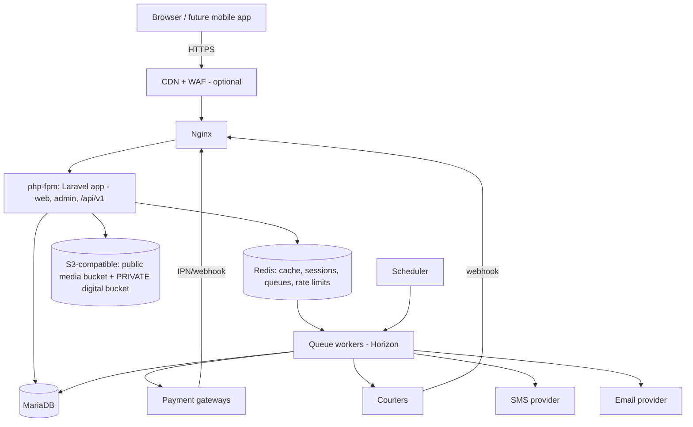
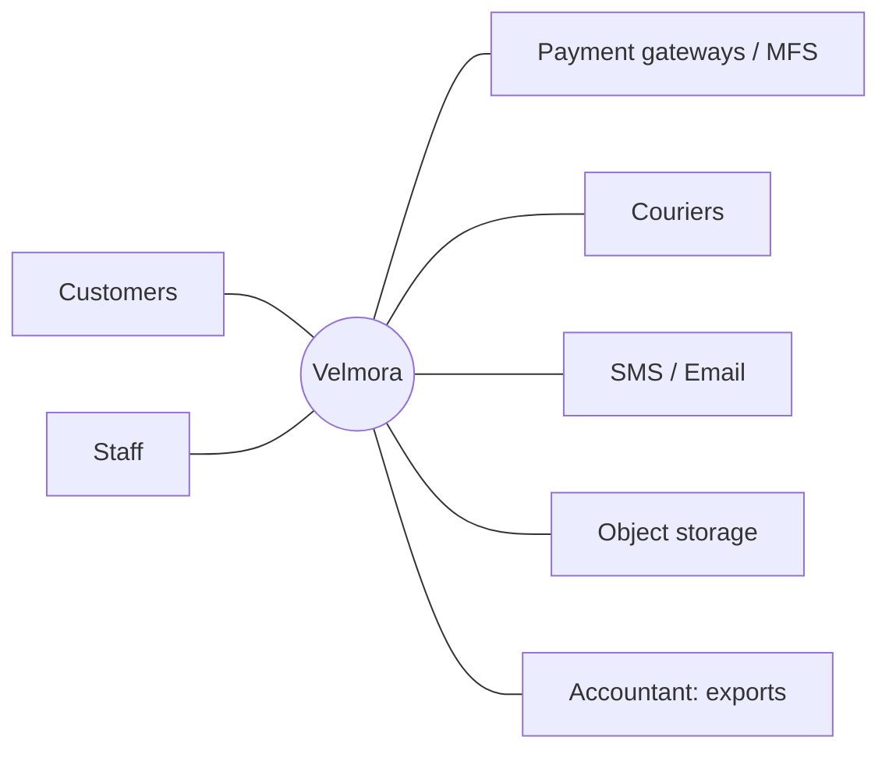

# System Architecture (Batch 2 draft)

Labels: [PINNED] from baseline/ADR-000 · [RECOMMENDATION] · [ASSUMPTION] · [UNVERIFIED]. DB = **MariaDB** (ADR-000).

## 1. Runtime topology

One deployable Laravel app, three processes: **web (php-fpm)**, **queue workers**, **scheduler**. No microservices [PINNED]. Search engine (S2 spike) would be a fourth, optional service.

## 2. Context


## 3. Request lifecycle
`Route → middleware (locale, rate-limit, auth, idempotency, request-id) → FormRequest (validate + normalise Bangla digits/NFC) → Policy/permission → ONE Action (DTO + explicit Actor in) → Resource/View`. Actions never read session/request/auth globals [PINNED]. Web, Admin and API call the same Actions.

## 4. Sync vs async boundaries
| Sync (in request) | Async (queue, after commit via outbox) |
|---|---|
| Cart pricing, shipping quote, stock reserve, coupon redeem, order create (one DB transaction) | Notifications, invoice PDFs, search index updates, sitemap, report exports |
| Payment *initiate* (gateway call, short timeout) | Payment callback processing, `status()` reconciliation, courier webhook processing, entitlement creation, review aggregates, stock expiry |
Rule: no external HTTP call inside a DB transaction holding stock/order locks.

## 5. Order-placement transaction
```mermaid
sequenceDiagram
  participant C as Client
  participant CK as PlaceOrder Action
  participant INV as Inventory
  participant PR as Pricing
  participant OR as Orders
  participant DB as MariaDB
  C->>CK: submit (Idempotency-Key)
  CK->>DB: BEGIN (READ COMMITTED)
  CK->>PR: re-quote cart (server-side)
  CK->>INV: ReserveStock (conditional UPDATE, ascending variant_id)
  CK->>PR: RedeemCoupon (conditional UPDATE)
  CK->>OR: CreateOrder + lines snapshot + history
  CK->>DB: outbox OrderPlaced; clear cart
  CK->>DB: COMMIT
  CK-->>C: order ref (online pay → InitiatePayment next)
```
Deadlock (1213)/lock-wait (1205): bounded retry (≤3) with jitter. Idempotent replay returns the stored response.

## 6. Payment callback sequence
```mermaid
sequenceDiagram
  GW->>WebhookCtl: IPN
  WebhookCtl->>DB: store raw event UNIQUE(provider, event_id) → 200 fast
  WebhookCtl->>Queue: ProcessPaymentEvent
  Queue->>Gateway: verify() server-to-server
  Queue->>DB: BEGIN; SELECT payment FOR UPDATE
  Queue->>Queue: match amount+currency+reference+status
  Queue->>DB: idempotent transition; outbox PaymentSucceeded; COMMIT
  Outbox->>Orders: listener marks order paid
```
Browser return URL only triggers `VerifyPayment` and a "verifying…" page; it never marks paid [PINNED].

## 7. Event catalogue (initial)
| Event | Producer | Consumers | Delivery |
|---|---|---|---|
| OrderPlaced | Orders | Notifications, Shipping(optional), Reporting | outbox |
| OrderConfirmed | Orders | Shipping, Notifications | outbox |
| OrderCancelled | Orders | Inventory(release), Payments(refund flag), Notifications | outbox |
| PaymentSucceeded / PaymentFailed | Payments | Orders, Notifications | outbox (critical) |
| PaymentNeedsReview | Payments | Notifications(staff) | outbox |
| RefundSucceeded | Payments | Orders, DigitalProducts(revoke), Notifications | outbox |
| OrderPaid | Orders | DigitalProducts, Services | outbox |
| ShipmentCreated/Delivered/Failed/Returned | Shipping | Orders, Payments(COD), Notifications | outbox |
| CodCollected | Payments | Reporting | outbox |
| StockLow | Inventory | Notifications(staff) | after-commit |
| ProductPublished/Updated | Catalog | Search, Cache | after-commit |
| EntitlementGranted | DigitalProducts | Notifications | after-commit |
| BookingConfirmed/Cancelled | Services | Notifications, Orders | outbox |
| UserRegistered | IdentityAccess | Customers (create profile), Notifications (welcome) | outbox |
| CustomerAnonymised | Customers | Reporting, Notifications | audit only + Reporting |
| CouponRedeemed | Pricing | Reporting | after-commit |
| StockReserved | Inventory | audit only | after-commit |
| ReturnReceived | Shipping | Inventory (restock/quarantine), Orders (fulfilment axis), Payments (refund suggestion) | outbox |
| ReviewPublished | Engagement | Catalog (rating stats), Search | after-commit |
| AuditEvent | Platform | (audit only) | sync insert |

## 8. Outbox design
Table `outbox_messages(id, public_id, event_type, payload JSON, status, attempts, available_at, processed_at)`. Written **in the same transaction** as the state change. Dispatcher job polls `status='pending' AND available_at<=now` with `FOR UPDATE SKIP LOCKED` (MariaDB ≥10.6), dispatches, marks done. At-least-once delivery; consumers are idempotent (processed-event key per consumer). Failed beyond N attempts → dead-letter view.

## 9. Caching
| Layer | What | Invalidation |
|---|---|---|
| HTTP/CDN | Anonymous catalog pages, assets | TTL + purge on `ProductPublished` |
| Redis fragment | Menus, category trees, home sections | event-driven forget |
| Redis app | Settings, price/availability reads | short TTL; **never** used for stock truth |
| Browser | hashed Vite assets, fonts | immutable |
Stock and payment decisions always read the DB.

## 10. Failure modes and degradation
| Dependency down | Behaviour |
|---|---|
| Payment gateway | Hide online method (feature flag), COD stays; pending payments reconciled later |
| Courier API | ManualCourier; shipments queued for retry |
| SMS provider | Email fallback; OTP login degrades to password; alert |
| Redis | Fall back to DB sessions/cache where configured; queues stall → alert; checkout still works synchronously |
| Search engine (if added) | Fallback to DB LIKE/FULLTEXT category browse |
| Object storage | Catalog images 404 placeholder; digital downloads fail closed |
| DB failover | Read-only maintenance page; RTO ≤ 4 h [ASSUMPTION] |

## 11. Observability
Request-id on every log line and API response; JSON logs with redaction; Horizon; metrics for callback failures, pending payments, queue lag, deadlock retries.
